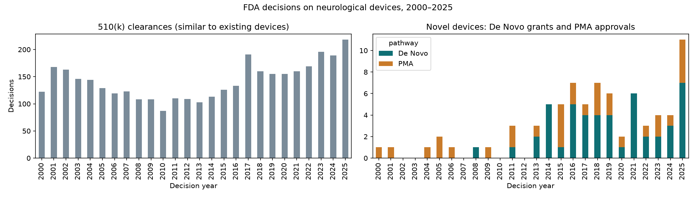

# Neuro Device FDA Outcomes & BCI Valuation

## Research question
What predicts whether, and how quickly, a novel neurological device reaches an FDA decision? And what does that imply for the probability of success and risk-adjusted value (rNPV) of current brain-computer interface (BCI) companies?

## Scope
- **Data sources:** ClinicalTrials.gov (API v2) and openFDA
- **Study type:** interventional trials with intervention type *Device*
- **Conditions:** epilepsy, Parkinson's disease, essential tremor, chronic pain, depression, migraine, obstructive sleep apnea, stroke, spinal cord injury, ALS
- **Trial start dates:** 2000–2021 for model training; later trials kept and treated as still in progress
- **BCI companies scored:** Synchron, Neuralink, Precision Neuroscience, Paradromics, Blackrock Neurotech

## Data snapshot (October 2026)
- **8,282** interventional device trials across 10 conditions, pulled with `src/fetch_trials.py`
- **Status:** 45% completed, 27% still running, 17% unknown, 10% stopped early
- **Sponsors:** 78% academic or hospital, 17% industry
- **66 BCI-related trials**, including Neuralink (6), Synchron (4), BrainGate/Blackrock (4) and Paradromics (1)

## Known issues
- **Broad device filter:** "Device" also covers monitoring tools, apps, CPAP machines and rehab equipment. A later step filters to therapeutic neurotech.
- **Uneven conditions:** stroke, depression and chronic pain make up about 60% of trials; ALS and essential tremor are small.
- **Unknown status (17%):** sponsors stopped updating these records, so outcomes are unclear.
- **Sponsor name variants:** the same company appears under several names (6 Medtronic variants; "Synchron Medical, Inc." vs "Synchron, Inc."). Names need standardizing before matching to FDA records.
- **Pre-2005 undercount:** trial registration only became widely required in 2005–2007, so early years are incomplete.
- **Keyword search limits:** a plain "synchron" search matched "synchronized" studies. BCI trials are identified with word-boundary patterns and checked by hand.
- **Missing companies:** no trials found for Precision Neuroscience; Blackrock appears only through academic BrainGate trials.
- **Survivorship bias in FDA data:** openFDA lists only approvals and clearances, not rejections or withdrawn submissions. Failures can only be inferred from trials that never reach an FDA decision.
- **Misfiled FDA records:** 8 of the 95 novel devices filed under the Neurology panel are not neuro devices (e.g., eye devices) and are excluded.
- **Review time includes waiting periods:** time from submission to decision includes periods when the FDA waits for the company's responses.
- **Pathway changes over time:** De Novo was rarely used before 2012, so older trials faced a different regulatory system.

## FDA decisions (openFDA)
- **6,176 decisions** on devices reviewed by the FDA Neurology panel, pulled with `src/fetch_fda.py`: 6,081 510(k) clearances, 52 De Novo grants and 43 original PMA approvals
- **Novel devices are rare:** about 4–10 De Novo + PMA decisions a year, against about 180 510(k) clearances
- **Median review time (2013 onward):** 510(k) about 4.5 months, De Novo about 11 months, PMA about 14 months. At a 12% discount rate, a typical PMA review alone reduces present value by about 12%.
- **The De Novo pathway took off after 2012,** when a law change (FDASIA) let companies apply directly

## BCI definition and finding
The 95 novel devices (De Novo + PMA) were hand-labeled by device type and BCI relevance (`data/processed/novel_devices_labels.csv`). Two definitions are used:
- **Narrow:** a device that reads electrical brain activity and uses it to control an external effector (e.g., a limb, orthosis or computer). This is the category Synchron and Neuralink are pursuing.
- **Broad:** a device that reads electrical brain activity and converts it into any output, including responsive stimulation.
- **Partial comparables:** devices with electrodes implanted in or on the brain or skull (deep brain stimulators, Epi-Minder), which share the surgical and long-term implant risk of invasive BCIs.

**Finding:** Two BCIs have been FDA-authorized: one implanted, therapeutic BCI under the broad definition (NeuroPace RNS, PMA, 2013) and one non-invasive motor BCI (Neurolutions IpsiHand, De Novo, 2021). No implanted BCI that controls an external device has been authorized yet.

## Status
✅ Phase 1: clinical trial data
✅ Phase 2: FDA decision data and device labels
⏭️ Next: linking trials to FDA decisions

