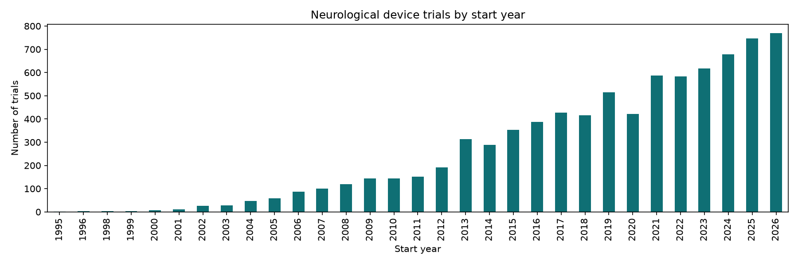

# Neuro Device FDA Outcomes & BCI Valuation

## Research question
What predicts whether, and how quickly, a novel neurological device reaches an FDA decision? And what does that imply for the probability of success and risk-adjusted value (rNPV) of current brain-computer interface (BCI) companies?

## Scope
- **Data sources:** ClinicalTrials.gov (API v2) and openFDA
- **Study type:** interventional trials with intervention type *Device*
- **Conditions:** epilepsy, Parkinson's disease, essential tremor, chronic pain, depression, migraine, obstructive sleep apnea, stroke, spinal cord injury, ALS
- **Trial start dates:** 2000–2021 for model training; later trials kept and treated as still in progress
- **BCI companies scored:** Synchron, Neuralink, Precision Neuroscience, Paradromics, Blackrock Neurotech

## Data snapshot (October 2026)
- **8,282** interventional device trials across 10 conditions, pulled with `src/fetch_trials.py`
- **Status:** 45% completed, 27% still running, 17% unknown, 10% stopped early
- **Sponsors:** 78% academic or hospital, 17% industry
- **66 BCI-related trials**, including Neuralink (6), Synchron (4), BrainGate/Blackrock (4) and Paradromics (1)

## Known issues
- **Broad device filter:** "Device" also covers monitoring tools, apps, CPAP machines and rehab equipment. A later step filters to therapeutic neurotech.
- **Uneven conditions:** stroke, depression and chronic pain make up about 60% of trials; ALS and essential tremor are small.
- **Unknown status (17%):** sponsors stopped updating these records, so outcomes are unclear.
- **Sponsor name variants:** the same company appears under several names (6 Medtronic variants; "Synchron Medical, Inc." vs "Synchron, Inc."). Names need standardizing before matching to FDA records.
- **Pre-2005 undercount:** trial registration only became widely required in 2005–2007, so early years are incomplete.
- **Keyword search limits:** a plain "synchron" search matched "synchronized" studies. BCI trials are identified with word-boundary patterns and checked by hand.
- **Missing companies:** no trials found for Precision Neuroscience; Blackrock appears only through academic BrainGate trials.

## Status
✅ Phase 1 complete: data collection
⏭️ Next: matching trials to FDA decisions (openFDA)